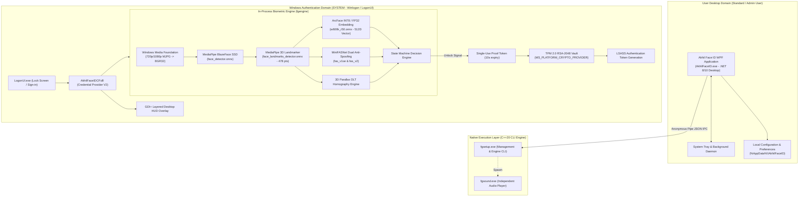
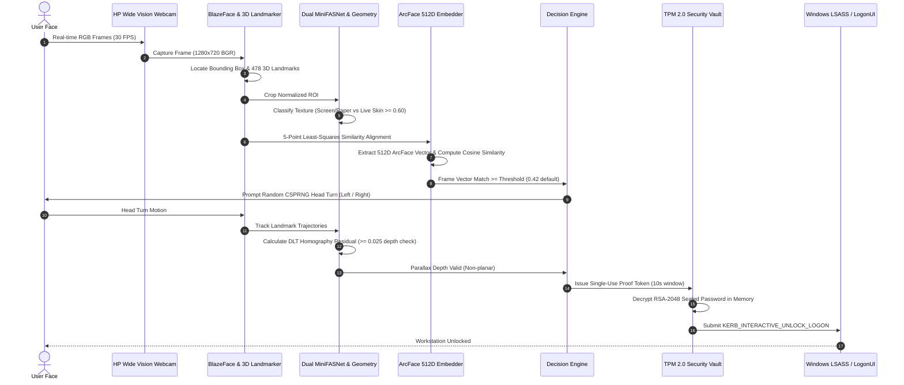

# ARCHITECTURE SPECIFICATION: AKHIL FACE ID

**Product:** Akhil Face ID  
**Architecture Classification:** Hardware-Assisted On-Device Biometric Desktop System  
**Target Platform:** Windows 11 (x64)  
**Primary Device Target:** HP Victus Laptop (Built-in HP Wide Vision HD Webcam `VID_0408&PID_5482`)

---

## 1. System Decomposition

Akhil Face ID operates across four isolated domains, maintaining zero network exposure and strict separation of privilege:



---

## 2. Biometric Verification & Liveness Pipeline



---

## 3. Storage and Filesystem Architecture

```
C:\Program Files\AkhilFaceID\            [Protected: Read-only for standard users]
├── AkhilFaceID.exe                     [Main WPF User Application]
├── AkhilFaceID.dll                     [Compiled Application Assembly]
├── AkhilFaceIDCP.dll                   [Windows Credential Provider V2]
├── fgsetup.exe                         [Native Engine CLI]
├── fgsound.exe                         [Standalone Audio Process]
├── onnxruntime.dll                     [ONNX Runtime Dynamic Library]
├── models\
│   ├── face_detector.onnx              [BlazeFace Short-Range Detector]
│   ├── face_landmarks_detector.onnx    [478 3D Landmark Regressor]
│   ├── fas_v1se_s4.0.onnx              [MiniFASNet Texture Anti-Spoof V1]
│   ├── fas_v2_s2.7.onnx                [MiniFASNet Texture Anti-Spoof V2]
│   ├── canonical_face.bin              [Procrustes Canonical Reference Model]
│   └── w600k_r50.onnx                  [InsightFace ArcFace 512D Recognition Model]
├── assets\
│   ├── sfx_unlock.wav                  [PCM WAV Sound Asset]
│   └── tile.bmp                        [LogonUI Sign-in Tile Icon]
└── RECOVERY.md                         [Emergency Offline Recovery Instructions]

C:\ProgramData\AkhilFaceID\             [Protected ACL: SYSTEM & Admins Full Control]
├── templates.bin                       [Biometric Enrolled Vectors - DPAPI Encrypted]
├── secret.tpm                          [TPM-Sealed RSA-2048 Password Container]
├── settings.json                       [System-wide Recognition Configuration]
├── log.txt                             [Application Event Log]
└── intruders\                          [AES-256-GCM Encrypted Intruder Snapshots]
```

---

## 4. Hardware Camera Interfacing

The HP Victus built-in camera is validated via Windows Media Foundation:
- **Symbolic Link:** `\\?\usb#vid_0408&pid_5482&mi_00#6&8323d14&0&0000#{e5323777-f976-4f5b-9b55-b94699c46e44}\global`
- **Bus Interface:** USB 2.0 Internal Hub (`VID_0408` Quanta Computer Inc, `PID_5482` HP Wide Vision HD Camera)
- **Format:** MJPG / YUY2 negotiated to 1280x720 at 30 FPS.
- **Hardware Filtering:** The engine validates the hardware prefix against `\\?\usb#`, strictly excluding virtual cameras (`root#`, `swd#`, OBS Virtual Camera, ManyCam) and HDMI capture devices.

